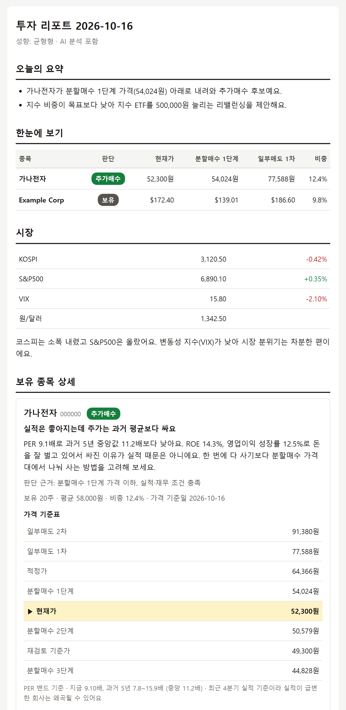

# trading-ai-agent

[](https://github.com/JoowonMun/trading-ai-agent/actions/workflows/tests.yml)

주식 초보 개인 투자자를 위한 **AI 투자 리포트 자동화 시스템**.
평일 아침마다 내 증권 계좌 잔고를 읽어 와서 공시·재무·시세·국민연금 동향으로 종목을 분석하고,
**근거가 붙은 쉬운 해설**을 메일로 보낸다.

데이터 수집과 모든 계산은 결정적인 파이썬 파이프라인이 맡고, 해설 작성은 **Claude Code 에이전트**가 맡는다.
에이전트는 계산 결과를 읽어 해설을 쓴 뒤 검증 명령을 직접 실행해 보고, 틀린 숫자가 있으면 스스로 고친다.

<p align="center"></p>
<p align="center"><sub>샘플 리포트 — 가상의 회사와 가짜 숫자 (<code>uv run python scripts/render_sample.py</code>)</sub></p>

> ⚠️ 개인 학습·참고용 프로젝트입니다. 리포트는 공개 데이터를 정해진 공식으로 계산한 결과이며 투자 권유가 아닙니다.

## 무엇을 해 주나

| 영역 | 내용 |
|---|---|
| 보유 종목 | NH투자증권 나무 Open API로 국내·미국 잔고 자동 수집 (조회 전용, 주문 API 차단) |
| 종목 분석 | PER·PBR·ROE·영업이익률·성장률·부채비율·배당수익률 + "좋음/보통/주의" 평가 |
| 가격 기준 | 과거 5년 **PER/PBR 밴드**로 적정가·분할매수 3단계·일부매도 2단계·재검토가 계산 |
| 판단 신호 | 추가매수 / 보유 / 일부매도 / 재검토 (규칙 기반, 우선순위 재검토 > 일부매도 > 추가매수 > 보유) |
| 포트폴리오 | 국내·미국·지수 자산군 비중 vs 목표, 리밸런싱 금액 제안, 단일 종목 쏠림 경고 |
| 국민연금 | 국내 연간 보유 순위, DART 지분 신고로 최근 변동, 미국 13F 분기 변동(많이 늘린·줄인 종목) |
| AI 해설 | Claude Code가 계산 결과를 초보자용 문장으로 풀어 씀 — 숫자는 코드가 검증 |
| 알림·주간 | 평일엔 변화(신호 변경·기준가 통과·±5%·새 공시·국민연금·실적 D-3)가 있을 때만 알림, 월요일엔 지난주 대비가 붙은 주간 리포트. 매일 스냅샷은 비공개 저장소에 기록 |

## 설계에서 신경 쓴 점

- **AI는 숫자를 만들지 않는다.** 모든 가격·지표는 파이썬이 계산해 `context.json`에 담고, AI는 해설(`analysis.json`)만 쓴다.
  [`report/validate.py`](src/agent/report/validate.py)가 해설 속 원·달러·%·배 단위 숫자(만·억·조 포함)를 종목별 context 값과 대조하고,
  신호는 "추가매수 → 보유" 하향만 허용한다. 검증에 실패하면 AI 해설 없이 숫자 리포트로 발송한다.
- **밴드 왜곡 가드.** 이익이 급변한 회사(예: 고성장 반도체)는 과거 PER 밴드가 현재와 맞지 않는다.
  적정가가 현재가의 2배 초과·절반 미만이면 "밴드 왜곡 가능"으로 표시하고 가격 기반 매수·매도 신호를 내지 않는다.
- **미래 정보 차단.** 밴드 계산 시 분기 실적은 공시 가능 시점(분기말 + 60일, 미국 연간 + 90일 / 분기 + 45일) 이후에만 쓴다.
- **DART 분기 데이터 해석.** 반기·3분기 보고서의 손익 `thstrm_amount`는 3개월치, `thstrm_add_amount`는 누적이라는 정의에 맞춰 분기 실적을 복원한다.
- **실패해도 메일은 온다.** 데이터 소스 하나가 실패하면 그 항목만 "데이터 누락"으로 표시하고 계속 진행하며, 전체가 실패하면 "생성 실패" 알림 메일을 보낸다.
- **개인정보는 git 밖에.** 보유 종목은 증권사 API로 매번 조회하고, 키는 환경변수(GitHub Secrets)로만 다룬다.
  공개 저장소의 Actions 로그에는 성공/실패와 개수만 남기고 종목·계좌번호·API 키는 가린다.

## 데이터 흐름

```
GitHub Actions (평일 06:17 KST, 월요일=주간 리포트 / 화~금=변화 있을 때만 알림)
 ├─ collect  : 나무 잔고 · pykrx/yfinance 시세 · DART 재무·공시 · yfinance 미국 재무
 │             · 국민연금(공공데이터포털, DART 지분공시, 13F) → 지표·밴드·신호·비중 계산
 │             → out/<날짜>/context.json
 ├─ Claude Code (구독 인증, claude -p) : prompts/analysis-guide.md 대로 analysis.json 작성
 │             → python -m agent check 로 스스로 검증·수정
 └─ publish  : 검증 → Jinja2 HTML 메일 (SMTP)
```

| 데이터 | 출처 |
|---|---|
| 국내 시세 / 수급 | pykrx (KRX 계정 있으면 외국인·기관 수급) |
| 국내 재무·공시 | OpenDART |
| 미국 시세·재무 | yfinance |
| 국민연금 국내 | 공공데이터포털 파일데이터, DART 지분공시(`elestock.json`) |
| 국민연금 미국 | 13F (SEC가 한국·클라우드 IP를 차단해 13f.info 경유) |
| 잔고 | NH투자증권 나무 PLUG Open API |

## 실행

```bash
uv sync --extra dev
cp .env.example .env                                   # 키 입력: docs/setup-keys.md
cp config/holdings.example.yaml config/holdings.yaml   # API로 못 가져오는 계좌만 (git 제외)

uv run pytest                                  # 단위 테스트 (외부 호출 없음)
uv run python -m agent run --dry-run           # 메일 대신 out/<날짜>/preview.html 생성
uv run python -m agent run                     # 수집 → 발송
```

매일 자동 발송 설정은 [docs/setup-github-actions.md](docs/setup-github-actions.md) 참고.

## 구조

```
src/agent/
  collectors/   dart · nh · prices · us_fundamentals · nps · sec13f
  analysis/     financials · fundamentals · valuation · signals · assessment · portfolio · disclosures · indicators
  report/       context (오케스트레이션) · schema · validate · render · templates/email.html · glossary
  delivery/     email
prompts/        analysis-guide.md (AI 작성 규칙) · daily-prompt.md
docs/superpowers/  설계 문서(spec)와 구현 계획(plan)
```

## 한계

- 가격 기준은 과거 5년 PER/PBR 밴드와 규칙 기반 신호뿐이며, 신호의 성과를 백테스트로 검증하지는 않았다.
- 국민연금 국내 지분 변동은 10% 이상 보유 종목의 신고만 잡힌다. 미국 13F는 분기 말 기준으로 약 45일 늦게 공개된다.
- pykrx·yfinance·13f.info는 비공식 데이터 소스라 구조가 바뀌면 깨질 수 있다(실패 시 해당 항목만 "데이터 누락").

## 문서

- [INTENT.md](INTENT.md) — 이 프로젝트의 목적·원칙·하지 않는 것·로드맵
- [CLAUDE.md](CLAUDE.md) — 개발 지침(작업 원칙, 불변식, 보안 규칙, 겪어본 함정)

## 개발 방식

설계 문서 → 구현 계획 → 테스트 먼저 작성(TDD) 순서로 [Claude Code](https://claude.com/claude-code)와 함께 개발했다.
설계와 계획, 진행 중 내린 결정은 [`docs/superpowers/`](docs/superpowers/)에 남아 있다.

## 라이선스

[MIT](LICENSE)
